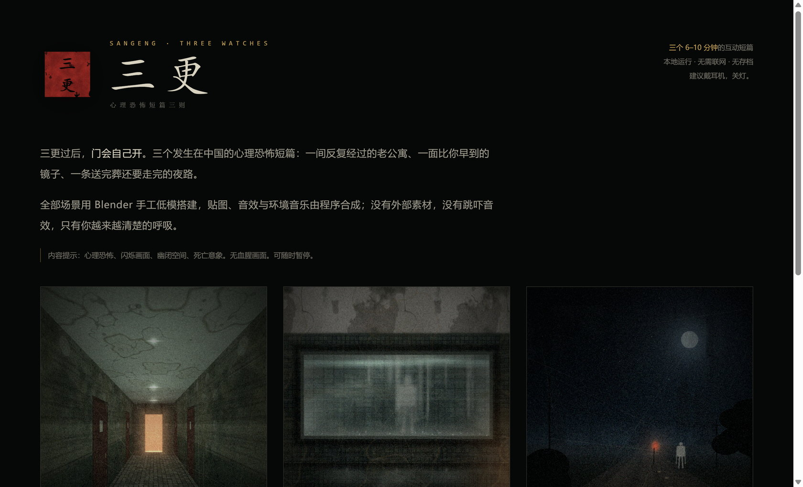
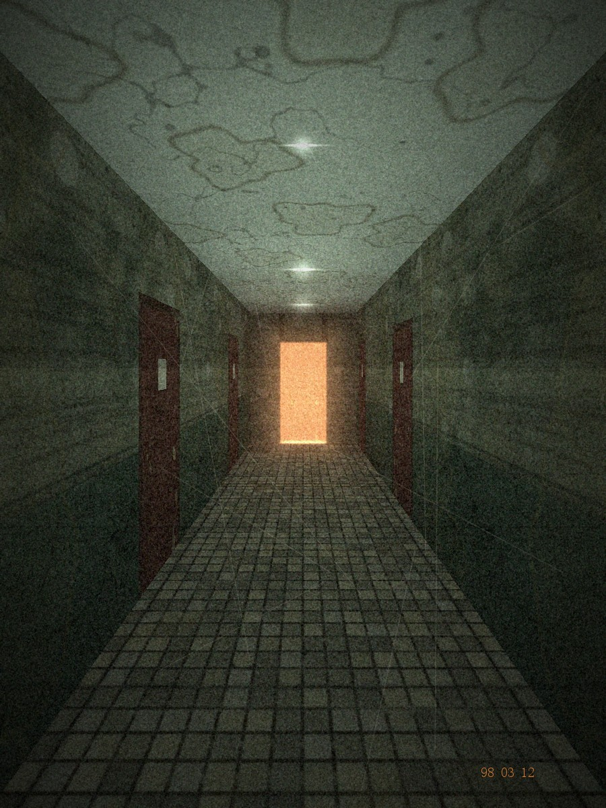
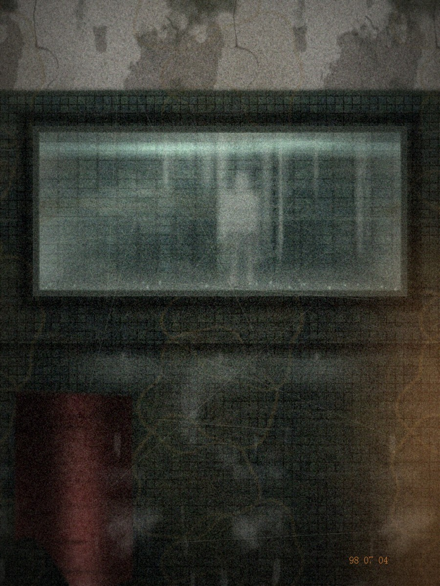
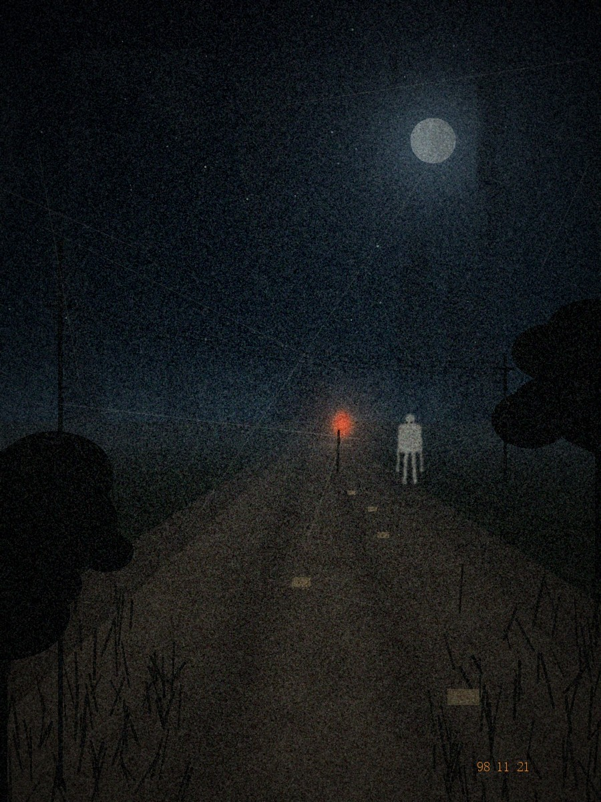
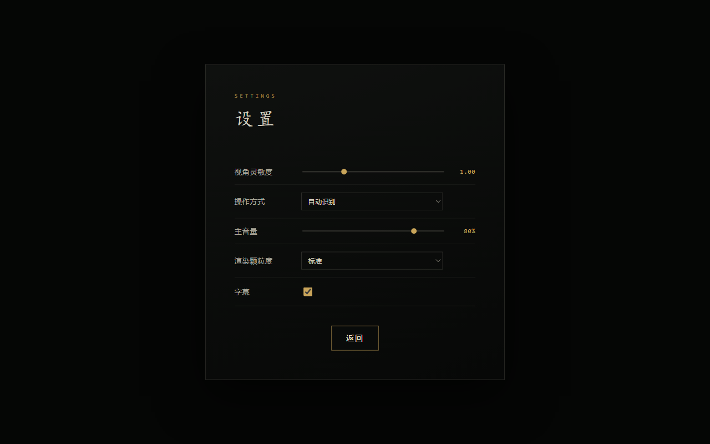
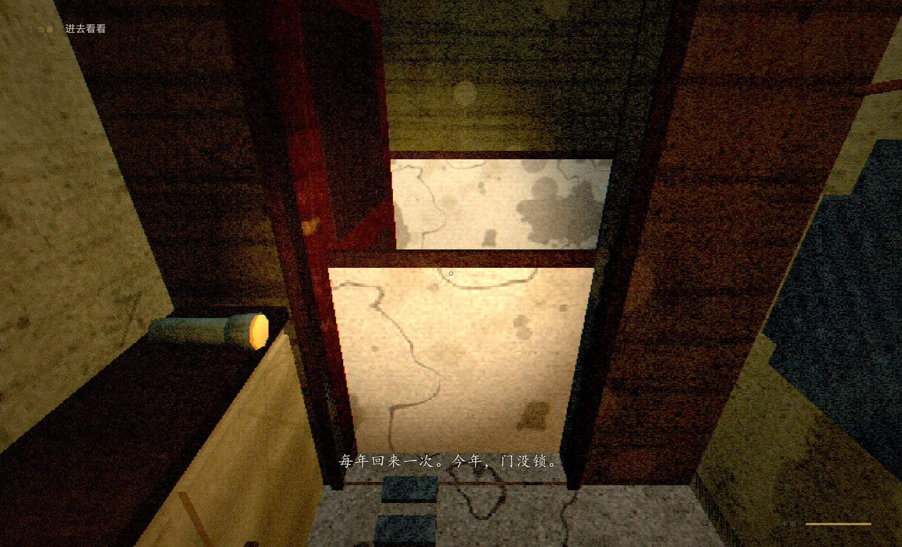
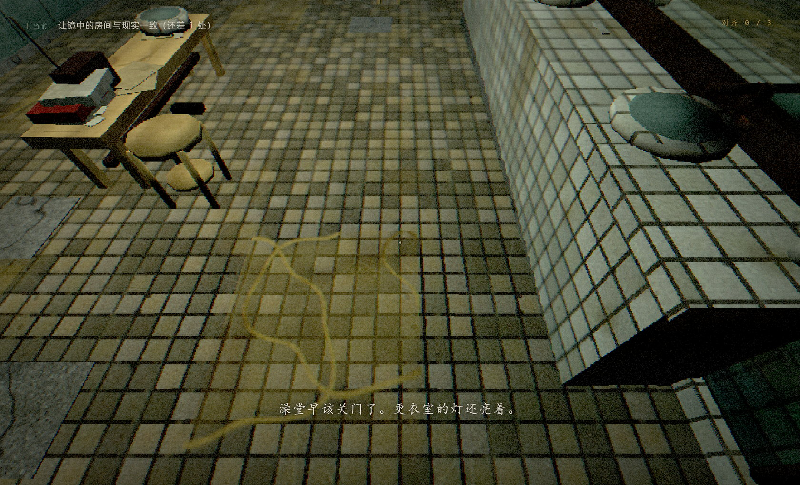
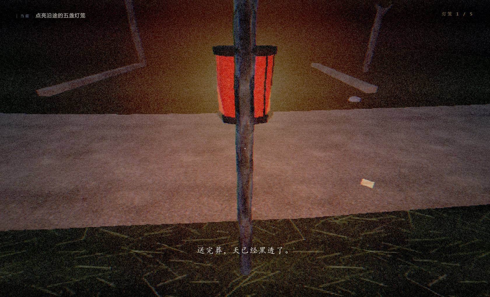
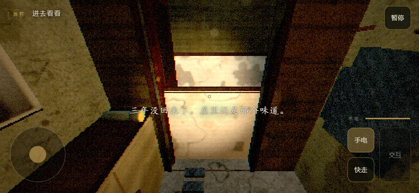

# 三更 · SANGENG

> 三个发生在中国的第一人称心理恐怖短篇：一间反复经过的老公寓、一面比你早到的镜子、一条送完葬还要走完的夜路。每篇 6–10 分钟，低多边形 3D、旧物材质与空间声场；没有跳吓音效，没有血腥画面。

[](https://kay-setsuna.itch.io/horror-demo)
[](https://github.com/intKay/Sangeng/releases/tag/v1.3.1)




| 一更《门后》 | 二更《镜中》 | 三更《夜路》 |
|---|---|---|
|  |  |  |
| 老公寓里的夜间探访 | 公共澡堂更衣室 | 乡野夜路上的灯火 |
| 约 6–8 分钟 | 约 5–7 分钟 | 约 7–10 分钟 |

## 1.6.0 旧屋美术返工候选

1.5 的审美结果已被用户否定。新分支 `codex/v1.6.0-art-direction` 优先返工《门后》：恢复材料分工，重做旧纸、漆木、织物与搪瓷的表现，把漏水、积灰与接触磨损放在有来源的位置；修复门洞遮挡与实心书柜，调整受光和近景轮廓。声音沿用 1.5。

运行 `python serve.py 8139`，打开 `http://127.0.0.1:8139/reports/av-v1.6/` 查看七机位的 1.4 / 1.5 / 1.6 对照，或进入首页游玩。[审美门槛](docs/art_direction_v1.6.md) · [制作、复现与验证范围](docs/av_iteration_v1.6.md)。1.5 回退标签 `codex/av-v1.5-before-art-review`，1.4 为 `codex/av-v1.4-before-upgrade`。本候选尚待用户审美接受，未替换下方 1.3.1 稳定发行。

## 下载游玩

| 平台 | 文件 | 说明 |
|---|---|---|
| 手机 / 桌面浏览器 | [`Sangeng-1.3.1-web.zip`](https://github.com/intKay/Sangeng/releases/download/v1.3.1/Sangeng-1.3.1-web.zip) | 同一个包适配电脑与触屏；用于静态托管或上传 itch.io。请勿在 ZIP 内直接双击 HTML。 |
| Windows 10/11 x64 | [`Sangeng-1.3.1-Setup-x64.exe`](https://github.com/intKay/Sangeng/releases/download/v1.3.1/Sangeng-1.3.1-Setup-x64.exe) | 安装版，内置 Electron/Chromium，离线运行。 |
| Windows 免安装 | [`Sangeng-1.3.1-Portable-x64.exe`](https://github.com/intKay/Sangeng/releases/download/v1.3.1/Sangeng-1.3.1-Portable-x64.exe) | 单文件便携版，双击即玩，首次启动会解包运行时。 |

全部文件、`SHA256SUMS.txt` 与构建 manifest 见 [v1.3.1 Release](https://github.com/intKay/Sangeng/releases/tag/v1.3.1)。网页包约 33 MB；桌面版约 144 MB，未数字签名，Windows 可能提示未知发布者。

浏览器需要支持 WebGL2 与 Web Audio 的现代版本；Edge / Chrome / Safari 均可。移动端建议横屏，竖屏也保留操作。第一次点击“开始”后解锁声音。

## 操作

| 动作 | 键鼠 | 触屏 |
|---|---|---|
| 移动 | `WASD` | 左下摇杆 |
| 环视 | 鼠标（点击画面锁定） | 右侧空白区域拖动 |
| 交互 | `E` | 右下“交互”按钮 |
| 快走 | `Shift` | “快走”按钮 |
| 手电（仅《门后》） | `F` | “手电”按钮 |
| 暂停 / 设置 | `Esc` | 右上“暂停” |

触屏和键鼠可以随时在设置里切换；摇杆在松手、失焦、旋转或暂停时清零。不支持 Ogg/Vorbis 的浏览器会自动改用同名 MP3 备用音频。

**不想被锁定鼠标**：设置 → 操作方式 → **鼠标拖动（不锁定指针）**。此时按住左键拖动环视，`WASD` / `E` / `Shift` 照常使用，`Esc` 仍然暂停，浏览器不会再捕获指针。默认的“键盘 / 鼠标（锁定指针）”手感更接近第一人称，可按需切换；选择会保存在本地。



**内容提示**：心理恐怖、闪烁画面、幽闭空间、死亡意象；无血腥画面。建议戴耳机，在安静、光线较暗的环境游玩。

## 画面

| 门后 | 镜中 | 夜路 |
|---|---|---|
|  |  |  |

手机横屏触控（摇杆、拖动环视与屏幕按钮）：



## 三个短篇

### 一更《门后》· 老公寓循环

你每年回来一次。今年，503 的门没锁。

- 在 503 里找到三张字条；每拿到一张，灯灭，你回到走廊开端，走廊和屋内发生细微变化。
- 手电有电量；黑暗里心跳会加快。
- 第三轮起，“她”出现在走廊。她只在你**不看她**时移动；被碰到就从头再来。
- 拿到三张字条后，回卧室，读床上的信。

### 二更《镜中》· 澡堂更衣室

九十年代的公共澡堂，夜里还有人。镜子里的人比你早到。

- 镜面实时渲染“另一间房”，两边状态并不一致。
- 三个回合，每回合把现实中的物件摆成镜中的样子（毛巾、阀门、灯、凳子、柜门、收音机、模特）。
- 每完成一回合（以及每次错误交互），镜中身影靠近一步；五步到身后 → 结束。
- 第三次对齐后，镜面碎裂。

### 三更《夜路》· 乡野夜行

送完葬，你一个人走夜路回家。身后多了一个人。

- 点亮沿途五盏纸灯笼，走到土地庙上香。
- 纸人只在你没看它时移动；连续注视超过约 2.5 秒会“夺灯”（最近一盏灯熄灭）。
- 点灯会短暂定住它，并成为死亡后的重生点。
- 庙前可选择回头 / 不回头，两段不同结局。

## 技术实现

- **渲染**：Three.js r160（`vendor/three/` 本地化，无 CDN）；内部渲染分辨率 45%–80% 再最近邻放大，配合胶片颗粒、扫描线、暗角、色差、抖动与低饱和调色，做出 PS1 低保真气质。
- **后处理**：`engine/postfx.js` 单通道全屏 Shader，`sanity / threat` 实时改变扭曲、色差、颗粒与心跳感。
- **第一人称**：`engine/player.js`——重力/阻尼移动、AABB 碰撞、头部摆动、脚步节拍、手电电量与低电闪烁。
- **交互**：中心射线拾取 + `E`；门有开合动画与碰撞联动。触屏层见 `engine/touch.js`。
- **音频**：`engine/audio.js`——manifest 驱动，音乐/环境交叉淡化，HRTF 空间声像，合成混响，实时心跳/呼吸/耳鸣层；MP3 兜底。
- **镜子**：`engine/mirror.js`——仿 three.js Reflector 的投影纹理平面反射；反射场景是关卡克隆，可与现实状态不同。
- **UI**：`engine/ui.js` + `engine.css`——标题/加载/HUD/字幕/暂停/设置/死亡/结局/信纸，原生 DOM，适配安全区与小屏滚动。
- **关卡**：`engine/engine.js`——加载 GLB、按 `MAT_*` 替换材质、读取 `LIGHT_*` Empty 建灯、提取 `COL_*` 碰撞、`SPAWN/LOOK/MARK` 标记、`V2_/V3_` 变体、`ENTITY_*` 实体。

所有 3D 场景、贴图、音效与音乐均为原创或程序化生成：Blender 5.2 headless 建模，numpy + Pillow 生成 62 张贴图，numpy 合成 121 个音频事件。没有外部下载素材、没有真人语音。资产规格见 [`docs/ASSET_SPEC.md`](docs/ASSET_SPEC.md)、[`docs/AUDIO_SPEC.md`](docs/AUDIO_SPEC.md)、[`docs/ART_SPEC.md`](docs/ART_SPEC.md)。

## 从源码运行与构建

```powershell
python serve.py          # 本地静态服务器，只用标准库
# 或双击 start_sangeng.cmd，然后打开 http://127.0.0.1:8137/
```

必须通过 HTTP 打开（ES Module、GLB 与音频不能从 `file://` 加载）。

```powershell
npm ci                   # Node.js 22.12+，首次需联网
npm start                # Electron 开发运行
npm run dist             # 构建 Windows 安装版 + 便携版
python tools/build_web.py  # 构建 Sangeng-1.3.1-web.zip
```

产物位于 `dist/desktop/` 与 `dist/web/`，附带 SHA-256、manifest 和 itch.io 上传说明。重建资产还需要 Blender、numpy、Pillow、ffmpeg 等各脚本列出的依赖；游玩与打包不需要这些依赖。

## 验证

v1.3.0 的完整验收见 [`reports/qa/release-1.3.0/ACCEPTANCE.md`](reports/qa/release-1.3.0/ACCEPTANCE.md)：网页包 Android 横屏 / 小屏手机模拟、桌面 Chromium 与独立 Electron 运行；三篇核心交互、门后手电、暂停/设置、字幕队列、死亡重试与结局；62 张贴图与 121 个音频就绪；GLB 命名、碰撞、材质与面数预算。339 个运行文件打包进网页 ZIP。

v1.3.1 在此基础上补充输入模式验收：默认键鼠模式仍会锁定指针，`Esc` 释放；切到“鼠标拖动（不锁定指针）”后不申请指针锁定，左键拖动可环视，点击画布也不会重新锁定；切回键鼠模式会恢复锁定。见 [`reports/qa/release-1.3.1/ACCEPTANCE.md`](reports/qa/release-1.3.1/ACCEPTANCE.md)。

## 已知限制

- 桌面版只提供 Windows x64；未做数字签名。
- 暂无存档与章节选择；单局 6–10 分钟，死亡就地重试。
- 低分辨率 + 颗粒是刻意的美术选择；设置里可调“清晰 / 标准 / 粗颗粒”。
- 镜面反射略暗、关灯回合灯管仍自发光等已知观感限制，记录在发布说明中。
- 自动化测试使用调试放置抵达交互附近；没有真人完整通关、人耳音量平衡或异机验收。

## 版本历史

| 版本 | 内容 |
|---|---|
| v1.3.1 | 新增“鼠标拖动（不锁定指针）”操作方式，解决测试/录屏时鼠标频繁被指针锁定；默认键鼠锁定手感不变。 |
| v1.3.0 | 接收场景内容打磨；网页包、安装版与便携版统一到 1.3.0；字幕队列修复；手机触控保留。 |
| v1.2.0 | 手机/桌面通用 HTML5 包：摇杆、拖动环视、屏幕按钮与安全区适配。 |
| v1.1.0 | 内置 Electron/Chromium 的 Windows 独立桌面版。 |
| v1.0.1 | 修复音源未接入混音图导致的无声、隐藏物件拦截交互、长按 `E` 重复触发。 |

## 目录结构

```
Sangeng/
  index.html            入口（三张海报卡片）
  serve.py              本地服务器（多线程，无依赖）
  engine/               共享引擎：engine / player / audio / ui / postfx / mirror / touch / utils
  games/                door《门后》 / mirror《镜中》 / nightroad《夜路》
  assets/               models / textures / audio / art
  tools/                Blender、美术、音频生成与发布 / 验收脚本
  docs/                 设计、接口、资产规格、分享与 itch.io 说明
  reports/              验收证据、报告与截图
  vendor/               three.js r160 + GLTFLoader（MIT）
```

## 原创与许可

玩法代码、场景、贴图、音效与音乐均为本项目原创或程序化生成。仓库暂未为原创部分提供独立开源许可证，其它使用许可请联系仓库作者；请勿将 demo 录屏用于商业发行。Three.js 及 addons 依 MIT 许可本地分发，完整声明见 [`vendor/three/LICENSE`](vendor/three/LICENSE) 与 [`NOTICE.md`](NOTICE.md)。
